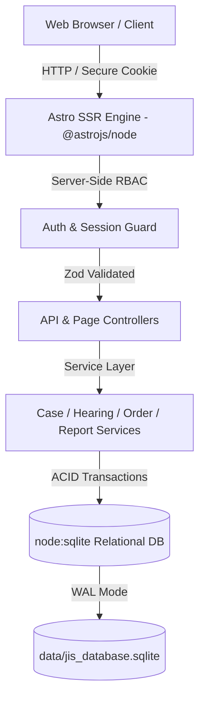

# 🏛️ Judiciary Information System (JIS)

[](https://astro.build/)
[](https://www.typescriptlang.org/)
[](https://nodejs.org/)
[](https://sqlite.org/)
[](tests/jis.test.ts)
[](docs/requirements-traceability.md)
[](LICENSE)

> **Official Court Case Management, Judicial Scheduling, Cause List Generation & Record-Keeping System**  
> Engineered strictly according to **IEEE Std 830-1998**, the **e-Courts Mission Mode Project**, and **National Judicial Data Grid (NJDG)** standards.

---

## 📑 Table of Contents

- [Overview](#-overview)
- [System Architecture & Stack Rationale](#-system-architecture--stack-rationale)
- [Core Features](#-core-features)
- [Demonstration Roles & Credentials](#-demonstration-roles--credentials)
- [Directory Structure](#-directory-structure)
- [Database Schema & Data Model](#-database-schema--data-model)
- [Quick Start & Installation](#-quick-start--installation)
- [Automated Test Suite](#-automated-test-suite)
- [REST API Reference](#-rest-api-reference)
- [Security & Case Immutability](#-security--case-immutability)
- [Requirements Traceability](#-requirements-traceability)
- [License](#-license)

---

## 🏛️ Overview

The **Judiciary Information System (JIS)** is a high-integrity, database-backed court management platform designed to automate and monitor the entire life-cycle of judicial proceedings. From e-filing scrutiny and automated Case Identification Number (CIN) allocation to conflict-free hearing calendar scheduling, mandatory adjournment auditing, signed decree issuance, and final case disposal.

### Core Objectives
1. **Paperless Case Dossier**: Complete historical timeline of petitions, pleadings, hearings, adjournments, orders, and documents.
2. **Automated CIN Generation**: Standardized `STATE-COURT-TYPE-YEAR-SEQUENCE` format (e.g., `DL-HC-CIV-2026-0001`).
3. **Conflict-Free Hearing Scheduling**: Real-time algorithmic verification of courtroom and judge availability to prevent double-booking.
4. **Adjournment Auditing & Running Tally**: Mandatory reason logging, rescheduling, and automatic incrementing of adjournment counters to identify protracted cases.
5. **Orders & Final Judgments**: Direct attachment of signed decrees; automated status transitions to `DISPOSED` upon final judgment pronouncement.
6. **Case Immutability Safeguards**: Closed cases cannot be altered by normal users; modifications by administrators are strictly audited.
7. **Role-Based Access Control (RBAC)**: Strict role-scoping ensuring lawyers only access assigned matters and litigants view only their personal cases.
8. **Administrative Analytics**: Real-time computation of case disposal rates, pendency aging buckets, adjournment cause analysis, and judicial bench workloads.

---

## 🏗️ System Architecture & Stack Rationale



- **Frontend & Web Framework**: [Astro v5](https://astro.build/) in Server-Side Rendering (`output: 'server'`) mode with `@astrojs/node` standalone adapter.
- **Runtime**: Node.js v24 LTS (or v22.12.0+).
- **Database Engine**: Persistent Relational SQLite via Node.js native `node:sqlite` (`PRAGMA journal_mode = WAL;` and `PRAGMA foreign_keys = ON;`).
- **Styling**: Tailored design system adhering to [`DESIGN.md`](DESIGN.md) (warm parchment `#f7f4ed`, deep charcoal `#1c1c1c`, gold accent `#d4af37`, responsive data grids, accessible status badges, and print optimization).
- **Security & Validation**: PBKDF2 with SHA-512 (100,000 iterations), HMAC-SHA256 session tokens, Zod schema runtime validation, and XSS sanitization.

### Why Astro SSR + SQLite (`node:sqlite`)?
1. **Air-Gapped Sovereign Court Deployment**: Judicial records cannot be hosted on multi-tenant cloud databases abroad. Local SQLite guarantees sovereign, self-contained, air-gapped court intranet compliance.
2. **Zero-Dependency Native Execution**: Built-in `node:sqlite` requires no external C++ compilers, MSVC build tools, or python gyp scripts.
3. **ACID Transactions**: Full transactional safety (`BEGIN` / `COMMIT` / `ROLLBACK`) for multi-step case registrations, adjournments, and closures.
4. **Performance**: Zero-JS client hydration overhead for static UI, sub-2ms local query execution, and sub-second page loads.

---

## ⚡ Core Features

| Feature | Description | File Reference |
| :--- | :--- | :--- |
| **CIN Generation** | Auto-generates unique, NJDG-compliant identifiers: `STATE-COURT-TYPE-YEAR-SEQ` | [`src/lib/services/caseService.ts`](src/lib/services/caseService.ts) |
| **Case Registration** | Official e-filing intake with mandatory field validation and initial document attachment | [`src/pages/cases/new.astro`](src/pages/cases/new.astro) |
| **Role-Scoped Search** | Search cases by CIN, type, status; automatically filtered to assigned matters for advocates and citizens | [`src/pages/cases/index.astro`](src/pages/cases/index.astro) |
| **Conflict-Free Scheduling** | Algorithmic verification preventing courtroom or judge double-booking | [`src/lib/services/hearingService.ts`](src/lib/services/hearingService.ts) |
| **Adjournment Tally** | Mandatory reason capture, rescheduling, and automatic incrementing of adjournment counter | [`src/pages/cases/[cin].astro`](src/pages/cases/[cin].astro) |
| **Orders & Decrees** | Issues interim orders, bail orders, and decrees with document uploads | [`src/lib/services/orderService.ts`](src/lib/services/orderService.ts) |
| **Auto-Disposal** | Pronouncing a final judgment automatically updates case status to `DISPOSED` and seals record | [`src/lib/services/orderService.ts`](src/lib/services/orderService.ts) |
| **Daily Cause List** | Daily courtroom hearing dockets with `@media print` optimization for notice board posting and CSV export | [`src/pages/causelist.astro`](src/pages/causelist.astro) |
| **Court Analytics** | Disposal ratios, pendency aging buckets (<3m, 3-6m, 6-12m, >1yr), and judge caseload analytics | [`src/pages/reports.astro`](src/pages/reports.astro) |
| **Audit Trail** | Tamper-evident logging of every critical judicial event with actor ID, IP address, and timestamp | [`src/pages/admin/audit.astro`](src/pages/admin/audit.astro) |

---

## 👥 Demonstration Roles & Credentials

The system is pre-seeded with realistic judicial personnel, advocates, and citizens:

| Role | Username | Password | Full Name & Designation | Permissions & Access Scope |
| :--- | :--- | :--- | :--- | :--- |
| **ADMIN** | `admin` | `admin123` | System Administrator | User management, audit logs, emergency closed-case updates |
| **JUDGE** | `judge.verma` | `judge123` | Hon'ble Justice R. K. Verma (Courtroom 1) | Assigned cases, hearing proceedings, interim orders, final judgments |
| **JUDGE** | `judge.sharma` | `judge123` | Hon'ble Justice Ananya Sharma (Courtroom 2) | Assigned cases, hearing proceedings, interim orders, final judgments |
| **CLERK** | `clerk.kumar` | `clerk123` | Rajesh Kumar (Senior Bench Registrar) | Case registration, CIN generation, hearing calendar, cause lists |
| **LAWYER** | `advocate.singh`| `lawyer123` | Adv. Vikram Singh (Bar: D/1420/2012) | Search & view assigned cases, hearing dates, download orders |
| **LAWYER** | `advocate.mehta`| `lawyer123` | Adv. Priya Mehta (Bar: D/1890/2015) | Search & view assigned cases, hearing dates, download orders |
| **LITIGANT** | `litigant.sharma`| `litigant123`| Ramesh Sharma (Petitioner) | View personal case dossier, hearing schedule, download orders |
| **LITIGANT** | `litigant.patel` | `litigant123`| Sunita Patel (Petitioner) | View personal case dossier, hearing schedule, download orders |

---

## 📁 Directory Structure

```
├── data/
│   ├── .gitkeep
│   └── jis_database.sqlite       # Local SQLite relational database (WAL mode)
├── docs/
│   └── requirements-traceability.md # Detailed IEEE 830 / SRS Traceability Matrix
├── src/
│   ├── components/
│   │   ├── Footer.astro          # Court portal footer
│   │   ├── Navbar.astro          # Navigation bar with role-aware menu
│   │   └── StatusBadge.astro     # Color-coded judicial status badges
│   ├── layouts/
│   │   └── BaseLayout.astro      # Master HTML shell, SEO metadata, fonts
│   ├── lib/
│   │   ├── auth.ts               # PBKDF2 hashing, HMAC session tokens, RBAC
│   │   ├── schema.ts             # Zod input validation schemas & sanitization
│   │   ├── db/
│   │   │   ├── index.ts          # DatabaseSync initialization & WAL setup
│   │   │   ├── schema.sql        # Relational schema (DDL & constraints)
│   │   │   ├── seed.ts           # Development seed data
│   │   │   └── run-seed.ts       # Standalone seed CLI script
│   │   └── services/
│   │       ├── caseService.ts    # CIN generation, case search & immutability
│   │       ├── hearingService.ts # Conflict checking, cause list, adjournments
│   │       ├── orderService.ts   # Orders, judgments, final disposal
│   │       ├── reportService.ts  # Disposal rates, pendency aging, judge workloads
│   │       ├── auditService.ts   # Tamper-evident audit logging
│   │       ├── notificationService.ts # Event alerts (SMS/Email)
│   │       └── userService.ts    # User CRUD & judicial directory
│   ├── pages/
│   │   ├── index.astro           # Homepage: stats, cause list preview, search
│   │   ├── login.astro           # Authentication with one-click demo logins
│   │   ├── dashboard.astro       # Role-tailored user dashboard
│   │   ├── causelist.astro       # Daily Cause List with print stylesheet
│   │   ├── hearings.astro        # Court calendar & scheduling interface
│   │   ├── notifications.astro   # User notification inbox
│   │   ├── reports.astro         # Administrative reports & court analytics
│   │   ├── admin/
│   │   │   ├── index.astro       # Admin router redirect
│   │   │   ├── users.astro       # User management & account creation
│   │   │   └── audit.astro       # System audit trail viewer
│   │   ├── api/                  # RESTful API endpoints
│   │   │   ├── auth/             # Login, logout, session verification
│   │   │   ├── cases/            # Search, register, details, update, close
│   │   │   ├── hearings/         # Scheduling, conflict checks, adjournments
│   │   │   ├── orders/           # Record orders, judgment decrees
│   │   │   ├── reports/          # Disposal & pendency metrics
│   │   │   └── users/            # User directory & creation
│   │   └── cases/
│   │       ├── index.astro       # Case records directory & search
│   │       ├── new.astro         # Case registration with live CIN preview
│   │       └── [cin].astro       # Complete Case Dossier
│   └── styles/
│       └── global.css            # Design tokens, variables & typography
├── tests/
│   └── jis.test.ts               # Automated verification suite (14 tests)
├── astro.config.mjs              # Astro configuration with @astrojs/node
├── package.json                  # Dependencies & execution scripts
├── tsconfig.json                 # TypeScript configuration
├── DESIGN.md                     # Design system law & aesthetic tokens
└── README.md                     # Project documentation
```

---

## 🗃️ Database Schema & Data Model

The database comprises 8 relational tables with foreign keys and cascade rules:

- **`users`**: Judicial officers, staff, advocates, litigants with PBKDF2 hash, designation, courtroom, and bar council registration.
- **`cases`**: Master case entity enforcing unique `cin`, filing date, status, category, parties, contact details, assigned judge, and running `adjournment_count`.
- **`hearings`**: Scheduled proceedings tracking courtroom, judge, purpose, status (`SCHEDULED`, `COMPLETED`, `ADJOURNED`, `CANCELLED`), and judicial proceedings summary.
- **`adjournments`**: Mandatory adjournment log recording prior hearing date, next hearing date, reason, requesting party, and courtroom.
- **`orders_judgments`**: Signed decrees, interim orders, bail orders, and final judgments with document URLs and disposal flags (`is_final`).
- **`case_documents`**: Case filings, evidence, affidavits, written statements, and signed order copies.
- **`notifications`**: User event dispatches via `SMS`, `EMAIL`, and `SYSTEM` channels.
- **`audit_logs`**: Permanent event trail recording actor, action type, description, client IP address, and timestamp.

---

## 🚀 Quick Start & Installation

### Prerequisites
- **Node.js**: `v20.0.0` or higher (`v24 LTS` recommended for native `node:sqlite`)
- **npm**: `v10.0.0` or higher

### 1. Clone the Repository
```bash
git clone https://github.com/Rayees1234/Judicary-Information-System.git
cd Judicary-Information-System
```

### 2. Install Dependencies
```bash
npm install
```

### 3. Initialize & Seed the Database
```bash
npm run seed
```
*Creates `data/jis_database.sqlite` and seeds 8 test users across all 5 roles, sample cases, hearings, orders, and audit logs.*

### 4. Run the Automated Test Suite
```bash
npm test
```

### 5. Start the Development Server
```bash
npm run dev
```
Open [http://localhost:4321](http://localhost:4321) in your browser.

### 6. Build & Run for Production
```bash
npm run build
node dist/server/entry.mjs
```

---

## 🧪 Automated Test Suite

The verification suite ([`tests/jis.test.ts`](tests/jis.test.ts)) validates all statutory and architectural requirements:

```bash
npm test
```

### Test Coverage Highlights
- `TEST-AUTH-001`: Cryptographic PBKDF2 password hashing with random salt.
- `TEST-AUTH-002`: HMAC-SHA256 session token generation and tamper detection.
- `TEST-AUTH-003`: Server-side RBAC restriction on case registration and judicial orders.
- `TEST-CIN-001`: CIN format adherence (`STATE-COURT-TYPE-YEAR-SEQ`).
- `TEST-CASE-001`: Mandatory fields validation upon registration.
- `TEST-CASE-002`: Case registration, CIN assignment, and audit event recording.
- `TEST-HRG-001`: Conflict-free scheduling (prevention of courtroom and judge double-booking).
- `TEST-ADJ-001`: Mandatory adjournment reason logging and running tally incrementation.
- `TEST-ORD-001`: Interim order recording on case dossier.
- `TEST-CLOSE-001`: Automatic transition to `DISPOSED` on final judgment pronouncement.
- `TEST-CLOSE-002`: **Case Immutability Rule**: Closed case rejects modifications by non-administrators.
- `TEST-SEARCH-001`: Lawyer role-scoping (only assigned cases visible).
- `TEST-SEARCH-002`: Litigant role-scoping (only personal matters visible).
- `TEST-REP-001`: Court analytics computation (disposal rate, pendency aging, judge workloads).

---

## 🔌 REST API Reference

| Endpoint | Method | Role Required | Description |
| :--- | :--- | :--- | :--- |
| `/api/auth/login` | `POST` | Public | Authenticates user and issues HTTP-only session cookie |
| `/api/auth/logout`| `POST` | Authenticated | Clears session cookie |
| `/api/auth/me` | `GET` | Authenticated | Returns current authenticated user profile |
| `/api/cases` | `GET` | Public / Scoped | Role-scoped case search with filters |
| `/api/cases` | `POST` | `CLERK`, `ADMIN` | Registers new case and generates CIN |
| `/api/cases/[cin]` | `GET` | Public / Scoped | Retrieves complete case dossier with hearings and orders |
| `/api/cases/[cin]` | `PUT` | Authenticated | Updates case metadata (rejected if case is disposed/closed) |
| `/api/cases/[cin]` | `POST` | `JUDGE`, `ADMIN` | Manually disposes/closes case with closure reason |
| `/api/hearings` | `GET` | Public | Retrieves cause list for given date and courtroom |
| `/api/hearings` | `POST` | `CLERK`, `ADMIN` | Schedules hearing with conflict checking |
| `/api/hearings/[id]/adjourn` | `POST` | `CLERK`, `ADMIN` | Adjourns hearing, logs reason, increments tally |
| `/api/orders` | `POST` | `JUDGE`, `ADMIN` | Records interim order or final judgment decree |
| `/api/reports` | `GET` | `JUDGE`, `CLERK`, `ADMIN` | Computes disposal rates, pendency buckets, workloads |
| `/api/users` | `GET` | Authenticated | Lists court officers, judges, advocates |
| `/api/users` | `POST` | `ADMIN` | Creates new user account |
| `/api/audit` | `GET` | `ADMIN` | Retrieves immutable system audit logs |

---

## 🔒 Security & Case Immutability

1. **Role-Based Access Control (RBAC)**: All mutating API routes and protected pages verify role permissions server-side before execution.
2. **Cryptographic Tokens**: Session cookies are signed with HMAC-SHA256 (`userId:role:timestamp:signature`). Any modification invalidates the session.
3. **Password Security**: Passwords are salted with 16 random bytes and hashed using PBKDF2 (SHA-512, 100,000 iterations). Plaintext passwords are never stored.
4. **Input Sanitization**: Incoming request bodies are parsed through strict Zod schemas. HTML tags (`<`, `>`) are automatically stripped to prevent XSS.
5. **Closed Case Immutability Safeguard**: Once a case is marked `DISPOSED`, `SETTLED`, or `CLOSED`, modifications by judges, clerks, lawyers, or litigants are rejected with HTTP 400. Only an Administrator can make post-disposal corrections, and all such modifications are logged to the audit trail.
6. **Double-Booking Prevention**: The hearing scheduler algorithmically validates that neither the courtroom nor the assigned judge has an overlapping booking.

---

## 📋 Requirements Traceability

The complete mapping of SRS functional requirements, DFD processes, use case models, class diagrams, and sequence flows is documented in:
👉 [`docs/requirements-traceability.md`](docs/requirements-traceability.md)

---

## 📄 License

This project is licensed under the **MIT License**.

```
Copyright (c) 2026 Judiciary Information System (JIS)
```
